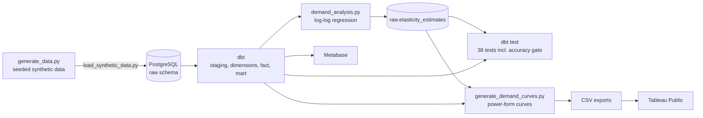

# Grocery Analytics Platform

[](https://github.com/fowlestravis/grocery-analytics-platform/actions/workflows/ci.yml)

A grocery pricing analytics platform that estimates price elasticity of demand using log-log regression, validates the methodology against known ground-truth elasticities in synthetic sales data, and surfaces actionable pricing recommendations through an interactive demand curve tool.

📊 **[View the Tableau Public Dashboard](https://public.tableau.com/app/profile/tvfowles/viz/Elasticityv2/Dashboard1)**

---

## Part 1 : The Pricing Tool

### Background

This dashboard is meant as a unit pricing guidance tool for assortment and promotional decisions made by retail category managers. It was inspired by and built using methodology from my time at Whole Foods Market. This implementation keeps the core analytical approach, while the synthetic grocery data source is built using a modern open-source stack, and the outputs are published to Tableau Public.

### The Business Problem

Retailers (and grocers especially) need to understand how changing an item's price will affect its demand. This is a fundamental concept in microeconomics. To use an example from this dataset: a 10% price increase on milk will not cause many customers to go without, because milk has inelastic demand. However, a 10% increase on potato chips could cut sales significantly due to their elastic demand — customers will either trade down to a lower tier brand or skip the chips entirely.

Quantifying these changes (what microeconomists call the price elasticity of demand) is an important part of pricing analysis, promotion planning, and category management. This project is meant to solve a common problem with retail data: gaps or lack of clean sales data. Each product in this synthetic dataset has a known elasticity assigned from category-appropriate ranges found in academic economics literature (generally speaking, dairy staples are relatively inelastic, snacks relatively elastic, etc.). Those known elasticities are baked into the synthetic transaction data, and the regression methodology is then tested to see whether it can recover them. If the methodology can recover elasticities we already know to be true, it passes a necessary first check before being applied to real transactional data, where the true elasticity is unknown.

**Key result:** The pipeline validates log-log regression methodology against known ground truth with a **2.4% average elasticity error** across 32 products.

### Demand Curve Methodology

The demand curves are the direct solution to the log-log regression described above, the constant-elasticity power form:

```
Q(P) = A × P^ε
```

- **ε** is the product's Method 2 estimated elasticity (the synthetic ground truth can be used instead with `--elasticity-source true`)
- **A** is calibrated so that predicted units at the product's average observed price equal its average daily units per store

Because ε is constant, a 1% price change moves units by ε% anywhere on the curve. Curves are generated by `scripts/generate_demand_curves.py`, which reads from the warehouse and writes the dashboard CSVs to `exports/`.

At any given price point the model predicts three curves:

- **Units**: volume response to price change
- **Sales**: revenue (units × price)
- **Contribution Margin**: direct product margin: `Contribution Margin = Sales − (Units × Cost)`

> **Note:** This is not a true contribution margin in the accounting sense, as it does not account for variable costs like labor, packaging, shrink, and theft. However, it makes sense as a target KPI for category managers and merchandising leadership, as finance typically sets margin targets at the category level against this metric.

In the real world, elasticity isn't perfectly constant across all prices. Diminishing marginal utility means the eighth unit of a product is worth less to a consumer than the first, so price sensitivity can shift as price deviates further from where customers are expecting it. The constant-elasticity assumption is a useful approximation for the price ranges typically seen in grocery retail, where prices typically move incrementally rather than dramatically.

### The Balance Point

The **balance point** is the price that maximizes contribution margin within the **guardrail window**: current price ± 20% (`[current × 0.8, current × 1.2]`), never below cost. It is found by evaluating the demand curve in $0.01 increments and taking the peak of the margin curve. The ±20% guardrail is adjustable (`--guardrail`).

For elastic products (ε < −1), the margin curve has a single peak at the unconstrained optimum:

```
P* = cost × ε / (1 + ε)
```

Each product's balance point carries one of four flags:

| Flag | Meaning |
|---|---|
| **interior** | P* falls inside the observed price range; the balance point is P* |
| **extrapolated** | P* falls inside the guardrail window but outside the range of prices actually observed, so the recommendation relies on the demand curve beyond the data |
| **at guardrail** | P* lies beyond the guardrail window; the balance point is the guardrail edge closest to it |
| **no interior optimum** | ε ≥ −1 (inelastic): margin rises with price indefinitely, so the balance point is the upper guardrail by construction |

The best price within the observed range alone is also reported (`max_gig_price_observed`) for comparison.

The **margin opportunity** quantifies the margin being left on the table at the current retail price:

```
Margin Opportunity = Margin(balance_point_price) − Margin(current_price)
```

Expressed in average dollars per store per day, this metric is immediately actionable. A margin opportunity of $100/store/day across 300 stores represents $30,000/day in unrealized contribution margin.

### The Dashboard

The Tableau Public dashboard provides an interactive product-level pricing tool across 32 grocery products spanning four categories — Dairy, Produce, Snacks, and Beverages.

- **Product selector** — choose any product from a dropdown filter and all views will update dynamically
- **Three-curve demand visualization** — Sales and Contribution Margin plotted in dollars on the left axis and Units on a separate right axis, across the observed price range and the ±20% guardrail window. Vertical lines mark the current price and the balance point, and the shaded area marks prices beyond the observed range
- **Historical metrics panel** — current observed sales, contribution margin, units, and average retail price across all stores' observed sales
- **Balance point panel** — revenue at the balance point, maximum contribution margin, margin opportunity at the balance point (within the ±20% guardrail), margin opportunity using observed prices only, and the balance point itself, plus a short note on what limits the recommendation: the guardrail, no interior optimum for inelastic products, or an optimum beyond or within observed prices

### A Note on Tableau Public vs Metabase

The data pipeline runs a live Metabase instance connected directly to a PostgreSQL instance on a dedicated Mac Mini I use as a server. For ease of sharing externally, I elected to publish the pricing tool to Tableau Public instead, as no authentication is needed, and all the data can be accessed from a single URL. The tradeoff is that Tableau Public only supports static data, so the dashboard is built from CSV exports rather than a live connection. In production this would run on Tableau Server with data sources pointing at live data mart tables on a scheduled refresh.

### Model Limitations

The elasticity estimation methodology (log-log regression: `ln(Q) = β₀ + β₁ × ln(P)`) was validated at 2.4% average error across 32 products, with β₁ representing a constant elasticity — the percentage change in quantity demanded for a 1% change in price. The ~2.4% estimation error from Method 2 (within-product time series) never changes the recommended pricing direction for any product.

**Demand curve form.** Earlier versions of the dashboard used a log-linear (exponential) form (`Q(P) = a × e^(ε × P)`), which treats ε as a per-dollar effect, so the point elasticity varies with price. That form recommended a price cut for 26 of 32 products. The power form (`Q(P) = A × P^ε`) is the direct solution to the log-log model, and under it every product's balance point is a price increase.

**Constant elasticity beyond observed prices.** Observed prices span roughly −25% to +3% around the current price. The guardrail window reaches +20%, so most balance points sit well above any observed price and assume ε holds where there is no data. In practice, price sensitivity usually grows as prices move away from what customers expect (see Demand Curve Methodology), so extrapolated and at-guardrail recommendations likely overstate the margin opportunity. Within the observed range alone, the best price is the observed maximum for all 32 products.

**Inelastic products have no interior optimum.** When |ε| ≤ 1, a price increase loses proportionally fewer units than it gains in price, so margin rises without limit. The balance point for these products (all of Dairy, plus Lettuce) is the upper guardrail by construction. It points in the right direction but says nothing about how far to go.

**The guardrail is a business parameter, not an estimate.** The ±20% window reflects how far a category manager would plausibly move a price in one step, not anything learned from the data. For the 19 at-guardrail products the balance point and margin opportunity move one-for-one with it, so they should be read as "raise toward the guardrail", with competitive pricing and category strategy deciding the actual step.

**Demand curve inputs.** Curves use the Method 2 estimated elasticities by default, as a production implementation would, rather than the synthetic ground truth.

---

## Part 2 : The Data Engineering Stack

Part 1 covers what the dashboard says. This part covers how the numbers get there and how I checked that they can be trusted. Everything runs locally in Docker, and the full pipeline is rebuilt and tested on every pull request.

### Architecture



The steps run in this order: generate, load, dbt run, analysis, dbt test. Airflow runs that sequence on a schedule, and GitHub Actions runs it on a clean machine for every pull request.

### Synthetic data with known ground truth

Real retail data never tells you the true elasticity, so you can't grade an estimation method against it. To get around that, I generate the data. Each of the 32 products gets an elasticity drawn from a category-appropriate range, and that value is built into about 280,000 daily store and product records from 2023 and 2024. Prices move through promotions (about 20% of days, with discounts of 10 to 25%) and small everyday changes of up to 3% either way, demand gets about 15% random noise, and costs are 55 to 70% of base price. The generator is seeded, so every run produces the same prices and sales. Only the made-up store names change. Because the true answers are known, the regression can be scored.

### dbt layers and tests

Data lands in a raw schema in PostgreSQL, and dbt builds from there: a staging view that cleans the raw transactions, dimension tables for products and stores, a daily sales fact table, and a validation mart that compares estimated and true elasticities. 38 dbt tests cover the models and sources. One of them, `assert_elasticity_accuracy`, fails the build if the mean elasticity error goes above 5% or any single product goes above 10%. A change that pushes the error past either limit can't merge.

### Estimating elasticity

`analysis/demand_analysis.py` runs two log-log regressions. The first regresses average price against average units across the products in each category. It doesn't recover the true elasticities, because differences between products get mixed up with the effect of price, and I keep it as a comparison. The second fits each product's own time series and is the headline method, with a 2.4% average error across the 32 products. The estimates are written back to `raw.elasticity_estimates`, which is what lets dbt test them. If the script can't reach the database or can't write its results, it exits with an error instead of reporting success.

### Demand curves

The estimated elasticity feeds a constant-elasticity demand curve, `Q = A × P^ε`, with `A` set so predicted units at the average price match the average daily units. Curves are evaluated in $0.01 steps. The balance point is the margin-maximizing price within a ±20% guardrail around the current price. Each product also gets a flag for what limits its recommendation: the guardrail, no interior optimum (inelastic products), or an optimum inside or beyond the observed prices.

### Orchestration and infrastructure

Docker Compose runs PostgreSQL and Metabase, and a second compose file runs Airflow 2.7.3 with the LocalExecutor. The DAG, `daily_grocery_refresh`, runs the five steps above, retries a failed step once after five minutes, and writes failures to a log file. I'll be honest about its role: the data is seeded, so every refresh rebuilds identical data, which makes the DAG a demonstration of orchestration, not something the numbers depend on. I keep it paused. Credentials live in a gitignored `.env` file (`.env.example` is the template), and the compose files refuse to start without it.

### Continuous integration

On every pull request and every push to main, GitHub Actions starts a clean Ubuntu machine with a temporary PostgreSQL 15 database and runs the same steps as the DAG, plus 15 pytest tests and a check that the demand curve exports are not empty. A run takes a little under two minutes. Main is protected, so a pull request can't merge until the `pipeline` check passes.

### What I found and corrected

- **The curves didn't match the model I had validated.** The first dashboard drew exponential curves, but the validated regression assumes constant elasticity, and the two disagree about how elasticity changes with price. Under the old curves the dashboard recommended price cuts for 26 of 32 products. The power form is the direct solution of the validated model, and it recommends increases for all of them. I rebuilt the curves and published the corrected dashboard.
- **Most recommendations are set by the guardrail, not the data.** Under the corrected curves, 28 of 32 balance points sit at the edge of the ±20% guardrail, and 31 of 32 fall beyond prices seen in the data, because the generator only varies price by about 3% outside promotions. The dashboard now says so. Each product shows what limits its recommendation, the part of each curve beyond observed prices is shaded, and margin opportunity is shown both at the balance point and using observed prices only.
- **A failing script reported success.** The analysis script used to exit cleanly when it couldn't reach the database, so the next step, dbt test, could pass on stale estimates from an earlier run. It now fails immediately.
- **The first full-pipeline CI run caught a dependency problem.** A newer SQLAlchemy defaulted to a different Postgres driver, which broke any fresh install. It worked on my machine because of an older installed version. The dependency is now pinned, along with the four analysis libraries.

---

## Getting Started

```bash
cp .env.example .env   # then fill in your database and Metabase credentials
docker compose up -d    # starts PostgreSQL warehouse + Metabase
```

Docker Compose requires `.env` to be present — it will error on missing password variables. See `.env.example` for the full list.

## Run Kafka locally

A single Kafka broker in KRaft mode (no ZooKeeper), reachable from the host at `localhost:9092`. It needs no `.env`.

```bash
# Start the broker and wait until it reports healthy
docker compose -f docker-compose-kafka.yml up -d
docker inspect -f '{{.State.Health.Status}}' grocery_kafka

# Create a topic with 3 partitions
docker exec grocery_kafka /opt/kafka/bin/kafka-topics.sh --bootstrap-server localhost:9092 \
  --create --topic scratch --partitions 3 --replication-factor 1

# Produce a few messages (one per line; Ctrl-D to finish)
docker exec -it grocery_kafka /opt/kafka/bin/kafka-console-producer.sh --bootstrap-server localhost:9092 \
  --topic scratch

# Consume them from the start (Ctrl-C to stop)
docker exec -it grocery_kafka /opt/kafka/bin/kafka-console-consumer.sh --bootstrap-server localhost:9092 \
  --topic scratch --from-beginning

# Stop the broker (add -v to also delete its data volume)
docker compose -f docker-compose-kafka.yml down
```

## Known Limitations

- The data is synthetic. The 2.4% result shows the method works when its assumptions hold. It does not show it will on real data, where price endogeneity and confounders matter.
- Three products exceed 5% estimation error: **Bell Peppers** (6.2%, Produce), **Cheddar Cheese** (5.7%, Dairy), and **Greek Yogurt** (5.2%, Dairy). All have low-magnitude elasticities (|ε| < 1.3) where small absolute errors produce larger percentage errors.
- Balance points are mostly guardrail-limited, as described above. A generator with wider price variation, and costs derived from a known optimal price, would make the recommendations testable and is the next improvement.
- Tableau Public only supports static data, so the dashboard is built from CSV exports and doesn't refresh from the database.

## Key Dependencies

`dbt-postgres` · `pandas` · `numpy` · `scipy` · `matplotlib` · `seaborn` · `sqlalchemy` · `psycopg2-binary` · `faker` · `python-dotenv`
